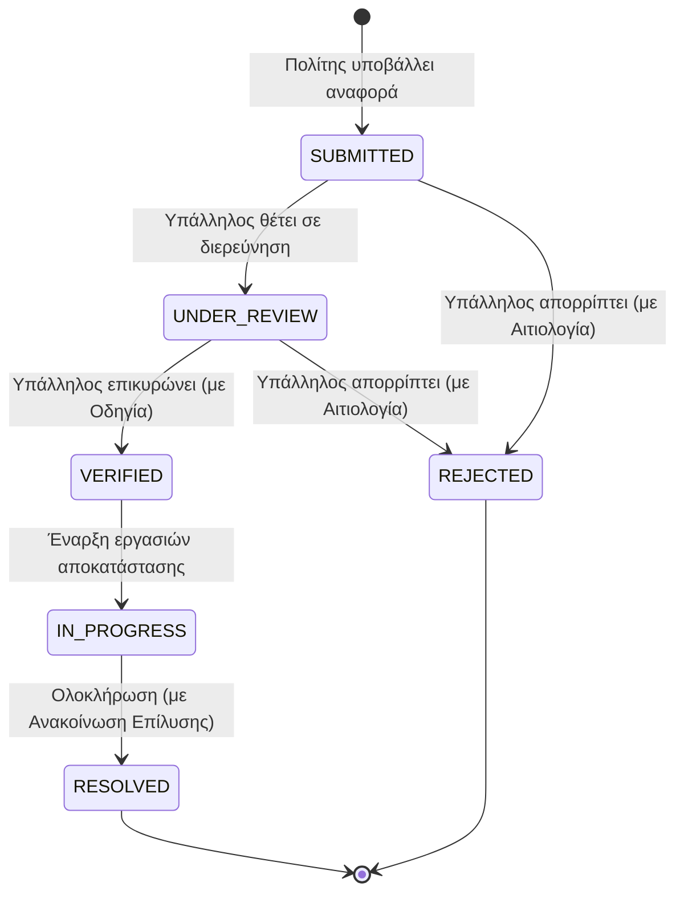

# Τεκμηρίωση Βασικών Αρχιτεκτονικών Επιλογών (CityFlow Architecture Documentation)

## 1. Εισαγωγή & Σκοπός του Συστήματος
Το **CityFlow** είναι μια σύγχρονη native εφαρμογή Android σχεδιασμένη για την έξυπνη διαχείριση της αστικής κινητικότητας και της προσβασιμότητας στις πόλεις. Συνδέει τους πολίτες με τις δημοτικές αρχές και τους φορείς μεταφορών σε πραγματικό χρόνο, επιτρέποντας:
* Τον εντοπισμό και την αναφορά εμποδίων προσβασιμότητας (αποκλεισμένες ράμπες ΑμεΑ, λακκούβες, βλάβες σηματοδοτών κ.ά.).
* Τον αυτόματο υπολογισμό προτεραιότητας συμβάντων μέσω αλγορίθμου χωρικής και χρονικής ομαδοποίησης.
* Τη real-time ενημέρωση των πολιτών μέσω γεωεντοπισμού (geo-fencing) και ειδοποιήσεων.
* Την ολοκληρωμένη διαχείριση του κύκλου ζωής αναφορών (υποβολή, έλεγχος, επικύρωση, επίλυση με ανακοίνωση, απόρριψη με αιτιολογία).

---

## 2. Γενική Αρχιτεκτονική (High-Level Architecture)

Η εφαρμογή υιοθετεί το πρότυπο **MVVM (Model-View-ViewModel)** σε συνδυασμό με τις αρχές του **Clean Architecture** και της **Μονοκατευθυντικής Ροής Δεδομένων (Unidirectional Data Flow - UDF)**.

```mermaid
graph TD
    subgraph UI Layer ["UI Layer (Jetpack Compose)"]
        Screens["Screens & Composables<br/>(CitizenHome, EmployeeDashboard, Stats, Profile)"]
        Nav["Navigation Component<br/>(AppNavHost & Screen Sealed Class)"]
    end

    subgraph ViewModel Layer ["ViewModel Layer"]
        VM["StateFlow ViewModels<br/>(CitizenHomeVM, EmployeeDashboardVM, AuthVM, StatsVM)"]
    end

    subgraph Domain Layer ["Domain Layer (Business Logic)"]
        PriorityCalc["PriorityCalculator<br/>(Αλγόριθμος Προτεραιότητας & Clustering)"]
        DistCalc["DistanceCalculator<br/>(Haversine Formula & Proximity)"]
    end

    subgraph Data Layer ["Data Layer (Repository Pattern)"]
        ReportRepo["ReportRepository"]
        AuthRepo["AuthRepository"]
    end

    subgraph External Services ["External Services & Local APIs"]
        Firestore["Cloud Firestore (Real-time NoSQL)"]
        FirebaseAuth["Firebase Authentication"]
        LocationAPI["Google Fused Location Provider"]
        Notifications["Android Notification Manager"]
    end

    Screens --> Nav
    Screens --> VM
    VM --> Domain Layer
    VM --> Data Layer
    ReportRepo --> Firestore
    ReportRepo --> Domain Layer
    AuthRepo --> FirebaseAuth
    AuthRepo --> Firestore
    VM --> LocationAPI
    VM --> Notifications
```

---

## 3. Ανάλυση Αρχιτεκτονικών Επιπέδων (Layers)

### 3.1. UI Layer (Presentation)
* **100% Jetpack Compose:** Πλήρης εγκατάλειψη του παραδοσιακού συστήματος XML Views υπέρ του σύγχρονου δηλωτικού (declarative) UI framework της Google.
  * *Αιτιολόγηση:* Μειώνει δραστικά τον boilerplate κώδικα, εξαλείφει σφάλματα συγχρονισμού καταστάσεων (view binding issues) και προσφέρει native υποστήριξη δυναμικών αλλαγών (recomposition).
* **Material 3 Design System:** Χρήση του τελευταίου σχεδιαστικού προτύπου Material 3 με ενιαία παλέτα χρωμάτων, δυναμική υποστήριξη **Dark Theme / Light Theme**, και responsive κάρτες/κουμπιά.
* **Single Activity Architecture:** Η εφαρμογή διαθέτει ένα μοναδικό σημείο εισόδου ([`MainActivity.kt`](file:///mnt/c/Users/riaek/AndroidStudioProjects/CityFlow/app/src/main/java/com/example/cityflow/MainActivity.kt)), και η πλοήγηση διαχειρίζεται αποκλειστικά από το `Jetpack Navigation Compose` μέσω sealed classes ([`Screen.kt`](file:///mnt/c/Users/riaek/AndroidStudioProjects/CityFlow/app/src/main/java/com/example/cityflow/ui/navigation/Screen.kt)), διασφαλίζοντας compile-time type safety στις διαδρομές.

### 3.2. ViewModel Layer & State Management
* **Unidirectional Data Flow (UDF):** Τα ViewModels εκθέτουν αμετάβλητες καταστάσεις (`StateFlow<T>`), τις οποίες τα Composables καταναλώνουν με `collectAsState()`. Τα UI events αποστέλλονται πίσω στο ViewModel ως απλές κλήσεις συναρτήσεων.
* **Reactive Coroutine Streams:** Χρήση Kotlin Coroutines (`viewModelScope`) και `combine / map / stateIn` operators για την αυτόματη ανάμιξη δεδομένων (π.χ. συνδυασμός θέσης GPS χρήστη και λίστας αναφορών για τον υπολογισμό κοντινών ειδοποιήσεων σε πραγματικό χρόνο).
* **Resource Wrapper Pattern:** Όλα τα αποτελέσματα ασύγχρονων πράξεων τυποποιούνται μέσω της generic sealed class [`Resource<T>`](file:///mnt/c/Users/riaek/AndroidStudioProjects/CityFlow/app/src/main/java/com/example/cityflow/data/model/Resource.kt) (`Idle`, `Loading`, `Success`, `Error`), προσφέροντας προβλέψιμη διαχείριση UI loaders και σφαλμάτων.

### 3.3. Domain Layer (Επιχειρησιακή Λογική)
Απομονωμένο επίπεδο καθαρής Kotlin λογικής, χωρίς εξάρτηση από Android Framework APIs, γεγονός που καθιστά τον κώδικα **100% ελέγξιμο μέσω Unit Tests** ([`PriorityAndDistanceTest.kt`](file:///mnt/c/Users/riaek/AndroidStudioProjects/CityFlow/app/src/test/java/com/example/cityflow/domain/PriorityAndDistanceTest.kt)).
* **Αλγόριθμος Υπολογισμού Προτεραιότητας ([`PriorityCalculator.kt`](file:///mnt/c/Users/riaek/AndroidStudioProjects/CityFlow/app/src/main/java/com/example/cityflow/domain/PriorityCalculator.kt)):**
  Υπολογίζει δυναμικά το σκορ σοβαρότητας ($P$) κάθε αναφοράς βάσει γραμμικού συνδυασμού κανονικοποιημένων παραγόντων:
  $$P = w_1 \cdot C_{norm} + w_2 \cdot D_{norm} + w_3 \cdot S_{norm}$$
  Όπου:
  * $w_1, w_2, w_3$: Δυναμικά βάρη ρυθμιζόμενα σε πραγματικό χρόνο από τον Administrator.
  * $C_{norm}$: Πλήθος παρόμοιων αναφορών στον ίδιο τόπο και χρόνο (Cluster Count).
  * $D_{norm}$: Χωρική εγγύτητα (Spatial Proximity) των αναφορών του ίδιου cluster.
  * $S_{norm}$: Εγγενής σοβαρότητα της κατηγορίας προβλήματος ($1 \dots 5$).
* **Υπολογισμός Γεωγραφικών Αποστάσεων ([`DistanceCalculator.kt`](file:///mnt/c/Users/riaek/AndroidStudioProjects/CityFlow/app/src/main/java/com/example/cityflow/domain/DistanceCalculator.kt)):**
  Υλοποίηση του μαθηματικού τύπου **Haversine**, υπολογίζοντας με ακρίβεια μέτρων την απόσταση μεταξύ δύο σημείων στην επιφάνεια της γης, υποστηρίζοντας το geo-fencing κοντινών ειδοποιήσεων.

### 3.4. Data Layer & Repository Pattern
* **Repository Pattern:** Αποσύνδεση των πηγών δεδομένων από την υπόλοιπη εφαρμογή. Τα ViewModels επικοινωνούν μόνο με το [`ReportRepository`](file:///mnt/c/Users/riaek/AndroidStudioProjects/CityFlow/app/src/main/java/com/example/cityflow/data/repository/ReportRepository.kt) και το [`AuthRepository`](file:///mnt/c/Users/riaek/AndroidStudioProjects/CityFlow/app/src/main/java/com/example/cityflow/data/repository/AuthRepository.kt).
* **Real-time Data Sync με Kotlin Flow:** Χρήση του `callbackFlow` για τη μετατροπή των snapshot listeners του Firestore σε ασφαλή Kotlin Flows, προσφέροντας άμεση ενημέρωση σε όλες τις συνδεδεμένες συσκευές χωρίς ανάγκη χειροκίνητου pull-to-refresh.
* **Atomic Batch Writes:** Κατά την υποβολή νέας αναφοράς, ενημερώνονται ατομικά (μέσω `firestore.batch()`) τόσο η νέα αναφορά όσο και όλες οι προηγούμενες αναφορές του ίδιου cluster με το νέο σκορ προτεραιότητας.

---

## 4. Κύκλος Ζωής Αναφοράς (Report Lifecycle & Workflow)

Η εφαρμογή υποστηρίζει μια αυστηρά καθορισμένη ροή καταστάσεων για κάθε αναφορά:



### Βασικές Εγγυήσεις Διαφάνειας:
1. **Απόρριψη με Υποχρεωτική Αιτιολογία (`rejectionReason`):** Ο υπάλληλος δεν μπορεί να απορρίψει αυθαίρετα ένα συμβάν. Καταγράφεται η αιτιολογία (π.χ. «Εκτός αρμοδιότητας», «Ψευδής αναφορά») και εμφανίζεται άμεσα στο ιστορικό του πολίτη.
2. **Επίλυση με Επίσημη Ανακοίνωση (`resolutionAnnouncement`):** Κατά την επίλυση συντάσσεται δημόσια ανακοίνωση, η οποία κοινοποιείται αυτόματα στην αρχική οθόνη των πολιτών («📢 Πρόσφατες Ανακοινώσεις Επίλυσης»).

---

## 5. Μοντέλο Ρόλων Χρηστών (Role-Based Access Control - RBAC)

Η εφαρμογή υποστηρίζει 3 διακριτούς ρόλους χρηστών:
* **CITIZEN (Πολίτης):**
  * Πρόσβαση στο feed κοντινών ειδοποιήσεων βάσει GPS.
  * Υποβολή αναφορών με φωτογραφία και αυτόματο στίγμα.
  * Προσωπικό ιστορικό αναφορών και στατιστικά.
  * Προβολή ανακοινώσεων επίλυσης και οδηγιών ασφαλείας.
* **EMPLOYEE (Υπάλληλος Δήμου / Μεταφορών):**
  * Real-time εποπτεία όλων των αναφορών της πόλης.
  * Φιλτράρισμα ανά κατάσταση και ταξινόμηση βάσει Priority Score.
  * Διαχείριση ροής εργασιών (Έλεγχος ➜ Επικύρωση ➜ Σε εξέλιξη ➜ Επίλυση / Απόρριψη).
* **ADMIN (Διαχειριστής Συστήματος):**
  * Δυναμική παραμετροποίηση των βαρών $w_1, w_2, w_3$ του αλγορίθμου.
  * Ρύθμιση προεπιλεγμένων ακτίνων ειδοποίησης ανά κατηγορία.
  * Πλήρης πρόσβαση στον πίνακα ελέγχου υπαλλήλου και στα επιχειρησιακά στατιστικά.

---

## 6. Διαχείριση Αποφυγής Διπλοτύπων (Anti-Spam / De-duplication)

Για την αποφυγή περιττής επιβάρυνσης των δημοτικών υπηρεσιών, υλοποιήθηκε χωροχρονικός έλεγχος κατά την υποβολή:
* Εάν ο ίδιος χρήστης υποβάλει αναφορά στην **ίδια κατηγορία**, εντός **ακτίνας 100 μέτρων** και εντός **30 λεπτών** από προηγούμενη δική του αναφορά, η υποβολή απορρίπτεται με σαφές μήνυμα στον χρήστη, αποτρέποντας πολλαπλές καταχωρήσεις για το ίδιο ακριβώς πρόβλημα.

---

## 7. Διεθνοποίηση & Προσβασιμότητα (Localization & I18n)

* **Πλήρης Διγλωσσία:** Η εφαρμογή είναι πλήρως μεταφρασμένη σε **Ελληνικά (`values/strings.xml`)** και **Αγγλικά (`values-en/strings.xml`)**.
* **Δυναμική Εναλλαγή Γλώσσας:** Μέσω του [`AppSettings`](file:///mnt/c/Users/riaek/AndroidStudioProjects/CityFlow/app/src/main/java/com/example/cityflow/util/AppSettings.kt), ο χρήστης μπορεί να αλλάξει γλώσσα ανά πάσα στιγμή μέσα από την εφαρμογή χωρίς επανεκκίνηση.
* **Localization επεκτάσεις στα δεδομένα:** Τα μοντέλα δεδομένων διαθέτουν extension properties ([`LocalizedModels.kt`](file:///mnt/c/Users/riaek/AndroidStudioProjects/CityFlow/app/src/main/java/com/example/cityflow/ui/common/LocalizedModels.kt)) που επιστρέφουν αυτόματα τις οδηγίες και τους τίτλους στη γλώσσα που έχει επιλέξει ο χρήστης.

---

## 8. Συμπεράσματα & Τεχνολογικά Οφέλη

| Αρχιτεκτονική Επιλογή | Εναλλακτική που Απορρίφθηκε | Πλεονέκτημα Επιλογής CityFlow |
| :--- | :--- | :--- |
| **Jetpack Compose** | XML Layouts & Fragments | Δηλωτικό UI, ταχύτερη ανάπτυξη, μηδενικά UI sync bugs. |
| **MVVM + StateFlow** | MVP ή LiveData | Cold/Hot streams με πλήρη συμβατότητα Coroutines και Multiplatform μέλλον. |
| **Pure Kotlin Domain** | Android-dependent Domain | 100% απομονωμένη επιχειρησιακή λογική, άμεσα εκτελέσιμα Unit Tests. |
| **Cloud Firestore** | REST API με Custom Backend | Real-time listeners out-of-the-box, offline persistence, μηδενικό server maintenance. |
| **Role-Based Workflows** | Ενιαία οθόνη για όλους | Αυστηρός διαχωρισμός αρμοδιοτήτων, ασφάλεια και βελτιστοποιημένο UX ανά ρόλο. |
