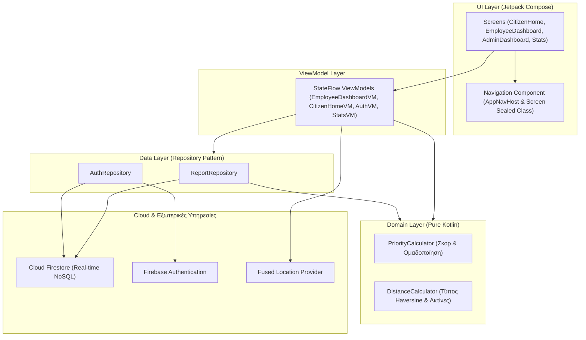

# CityFlow 🏙️

> 🇬🇷 **Ελληνικά** | [🇬🇧 English Version](README_EN.md)

Το **CityFlow** είναι μια σύγχρονη native εφαρμογή Android για την **Έξυπνη Αστική Κινητικότητα και Διαχείριση Προσβασιμότητας**, που αναπτύχθηκε στο πλαίσιο του μεταπτυχιακού μαθήματος *Ανάπτυξη Εφαρμογών για Κινητές Συσκευές* (Mobile Development) στο **Πανεπιστήμιο Πειραιώς (UniPi)**.

Η εφαρμογή συνδέει τους πολίτες με τις δημοτικές αρχές και τα τεχνικά συνεργεία σε πραγματικό χρόνο: αυτοματοποιεί τη διαλογή και προτεραιοποίηση αναφορών, ανιχνεύει χωροχρονικές ομαδοποιήσεις (clusters), αποστέλλει γεωγραφικές ειδοποιήσεις εγγύτητας (geofencing) και διαχειρίζεται πλήρως τον κύκλο ζωής των αστικών προβλημάτων.

---

## 📑 Πίνακας Περιεχομένων
1. [Βασικές Λειτουργίες ανά Ρόλο](#-βασικές-λειτουργίες-ανά-ρόλο)
2. [Αλγόριθμος Προτεραιότητας & Επιχειρησιακή Λογική](#-αλγόριθμος-προτεραιότητας--επιχειρησιακή-λογική)
3. [Αρχιτεκτονική & Σχεδιαστικά Πρότυπα](#-αρχιτεκτονική--σχεδιαστικά-πρότυπα)
4. [Προκαθορισμένοι Λογαριασμοί Αξιολόγησης (Demo Accounts)](#-προκαθορισμένοι-λογαριασμοί-αξιολόγησης-demo-accounts)
5. [Οδηγός Παρουσίασης: Εκτέλεση σε 2 Emulators](#-οδηγός-παρουσίασης-εκτέλεση-σε-2-emulators)
6. [Τεχνολογικό Stack](#-τεχνολογικό-stack)
7. [Δομή Έργου (Project Structure)](#-δομή-έργου-project-structure)
8. [Εγκατάσταση & Εκτέλεση](#-εγκατάσταση--εκτέλεση)

---

## 👥 Βασικές Λειτουργίες ανά Ρόλο

### 1. 🚶 Ροή Πολίτη (`CITIZEN`)
* **Υποβολή Αναφοράς:** Καταγραφή εμποδίων προσβασιμότητας (αποκλεισμένες ράμπες ΑμεΑ, λακκούβες, βλάβες σηματοδοτών, παράνομη στάθμευση κ.ά.) με:
  * Λήψη φωτογραφίας μέσω κάμερας (συμπιεσμένη αποθήκευση Base64).
  * Αυτόματο εντοπισμό GPS και αντίστροφη γεωκωδικοποίηση (οδός/αριθμός).
  * Εγγενή διαβάθμιση σοβαρότητας ανά κατηγορία.
* **Ειδοποιήσεις Εγγύτητας (Geo-fencing):** Υπολογισμός απόστασης από επικυρωμένα εμπόδια σε πραγματικό χρόνο και προειδοποίηση του πολίτη όταν πλησιάζει στην ακτίνα κινδύνου.
* **Προσωπικό Ιστορικό:** Παρακολούθηση της εξέλιξης των υποβληθεισών αναφορών και των αλλαγών κατάστασης.
* **Ροή Επισήμων Ανακοινώσεων:** Προβολή δημόσιων ανακοινώσεων αποκατάστασης από τα συνεργεία του Δήμου.
* **Μηχανισμός Αποφυγής Spam / Διπλοτύπων:** Αποτροπή πολλαπλών υποβολών για το ίδιο πρόβλημα από τον ίδιο χρήστη εντός ακτίνας 50 μέτρων και 30 λεπτών.

### 2. 👷 Ροή Υπαλλήλου Δήμου (`EMPLOYEE`)
* **Real-time Πίνακας Ελέγχου (Dispatch Queue):** Ζωντανή ροή Firestore (`callbackFlow`) με όλες τις υποβληθείσες αναφορές της πόλης χωρίς ανάγκη χειροκίνητης ανανέωσης.
* **Δυναμική Ταξινόμηση:** Αυτόματη κατάταξη βάσει αλγοριθμικού `PriorityScore` (πιο επείγοντα πρώτα) ή χρονολογικής σειράς.
* **Πολυκριτηριακό Φιλτράρισμα:** Φίλτρα κατάστασης (`Όλες`, `Υποβλήθηκε`, `Υπό Διερεύνηση`, `Επικυρώθηκε`, `Σε Εξέλιξη`, `Επιλύθηκε`, `Απορρίφθηκε`).
* **Αλγοριθμικά Badges Σοβαρότητας:** Οπτικές ενδείξεις (`Κρίσιμη`, `Υψηλή`, `Μέτρια`, `Χαμηλή`) με εμφάνιση του ακριβούς σκορ και του πλήθους ομαδοποιημένων αναφορών.
* **Διαχείριση Κύκλου Ζωής Αναφοράς:**
  * **Υπό Διερεύνηση:** Έναρξη αυτοψίας.
  * **Επικύρωση:** Επιβεβαίωση συμβάντος με δυνατότητα προσθήκης πρακτικής οδηγίας ασφαλείας.
  * **Σε Εξέλιξη:** Ανάθεση σε συνεργείο αποκατάστασης.
  * **Επίλυση:** Ολοκλήρωση εργασιών με επίσημη δημόσια ανακοίνωση.
  * **Απόρριψη:** Απόρριψη άκυρων αναφορών με υποχρεωτική αιτιολόγηση.
* **Πλοήγηση σε Εξωτερικούς Χάρτες:** Άμεσο άνοιγμα των συντεταγμένων του συμβάντος σε Google Maps ή άλλες εφαρμογές πλοήγησης.

### 3. ⚙️ Ροή Διαχειριστή Συστήματος (`ADMIN`)
* **Δυναμική Ρύθμιση Αλγορίθμου:** Διαδραστικά sliders για τη ρύθμιση των βαρών προτεραιότητας ($w_1$: Πλήθος, $w_2$: Εγγύτητα, $w_3$: Σοβαρότητα) στο εύρος `0.5` έως `5.0`.
* **Cloud Συγχρονισμός σε Όλες τις Συσκευές:** Οι παράμετροι αποθηκεύονται στο Cloud Firestore (`system_config/priority_weights`) και μεταδίδονται αυτόματα σε κάθε ενεργή συσκευή.
* **Αναδρομικός Επανυπολογισμός Ουράς (Retroactive Recalculation):** Με το πάτημα του κουμπιού *"Εφαρμογή Παραμέτρων"*, το σύστημα επανυπολογίζει άμεσα τα σκορ όλων των υφιστάμενων ενεργών αναφορών μέσω batch write, προκαλώντας ζωντανή ανακατάταξη και αλλαγή badges στο dashboard του υπαλλήλου.
* **Εποπτεία Κατηγοριών & Ακτίνων:** Επιθεώρηση των προεπιλεγμένων ακτίνων ειδοποίησης και των βασικών δεικτών σοβαρότητας για κάθε τύπο συμβάντος.
* **Γρήγορες Συντομεύσεις:** Άμεση μετάβαση στο Dashboard Υπαλλήλου, στα Στατιστικά και στις Ρυθμίσεις.

### 4. 📊 Στατιστικά & Προφίλ
* **Στατιστικά Προσαρμοσμένα ανά Ρόλο:** Συνολική εποπτεία κατανομής αναφορών, χρόνων απόκρισης και επιχειρησιακών δεικτών.
* **Διαδραστικά Γραφήματα:** Κατανομή ανά κατηγορία συμβάντος και ποσοστά κατάστασης επίλυσης.
* **Πλήρης Διγλωσσία (i18n):** 100% υποστήριξη Ελληνικών (`el`) και Αγγλικών (`en`) με άμεση εναλλαγή εντός της εφαρμογής.
* **Σκοτεινό / Φωτεινό Θέμα:** Υποστήριξη Dark / Light Theme μέσω Material 3 με αποθήκευση προτιμήσεων χρήστη.

---

## 🧮 Αλγόριθμος Προτεραιότητας & Επιχειρησιακή Λογική

Το CityFlow υλοποιεί ένα αμιγώς Kotlin domain μοντέλο για τον αντικειμενικό υπολογισμό της επείγουσας ανάγκης επέμβασης:

$$P = w_1 \cdot \text{Count} + w_2 \cdot \text{ProximityScore} + w_3 \cdot \text{Severity}$$

Όπου:
* **$\text{Count}$:** Πλήθος μοναδικών πολιτών που συνεισφέρουν στο cluster (αποτρέπει τεχνητή διόγκωση από έναν χρήστη).
* **$\text{ProximityScore}$:** Δείκτης χωρικής πυκνότητας ($0 \dots 10$) υπολογισμένος μέσω του τύπου **Haversine** για αναφορές εντός της ακτίνας cluster ($50\text{m}$).
* **$\text{Severity}$:** Εγγενής σοβαρότητα της κατηγορίας ($1 \dots 5$), π.χ. *Αποκλεισμένη Ράμπα ΑμεΑ* = 5.
* **$w_1, w_2, w_3$:** Δυναμικά βάρη ρυθμιζόμενα σε πραγματικό χρόνο από τον Administrator.

### Διαβαθμίσεις Προτεραιότητας:
| Εύρος Σκορ | Επίπεδο Προτεραιότητας | Χρώμα Badge |
| :--- | :--- | :--- |
| $\ge 25.0$ | **CRITICAL (Κρίσιμη)** | Κόκκινο |
| $18.0 \dots 24.9$ | **HIGH (Υψηλή)** | Πορτοκαλί |
| $12.0 \dots 17.9$ | **MEDIUM (Μέτρια)** | Κίτρινο / Κεχριμπάρι |
| $< 12.0$ | **LOW (Χαμηλή)** | Μπλε |

---

## 🏗️ Αρχιτεκτονική & Σχεδιαστικά Πρότυπα

Η εφαρμογή ακολουθεί αυστηρά τις αρχές του **Clean Architecture**, του **MVVM (Model-View-ViewModel)** και της **Μονοκατευθυντικής Ροής Δεδομένων (Unidirectional Data Flow - UDF)**:



* **Pure Kotlin Domain:** Τα [`PriorityCalculator.kt`](app/src/main/java/com/example/cityflow/domain/PriorityCalculator.kt) και [`DistanceCalculator.kt`](app/src/main/java/com/example/cityflow/domain/DistanceCalculator.kt) δεν έχουν καμία εξάρτηση από Android APIs, όντας 100% ελέγξιμα μέσω Unit Tests.
* **Coroutines & Kotlin Flow:** Χρήση του `callbackFlow` για τη μετατροπή των snapshot listeners του Firestore σε ασφαλείς αντιδραστικές ροές δεδομένων.
* **Atomic Batch Writes:** Ατομικές εγγραφές Firestore για τη διατήρηση συνέπειας κατά την ομαδοποίηση αναφορών και τον αναδρομικό επανυπολογισμό.
* **Resource Wrapper Pattern:** Generic κλάση `Resource<T>` (`Idle`, `Loading`, `Success`, `Error`) για προβλέψιμη διαχείριση ασύγχρονων καταστάσεων UI.

---

## 🔑 Προκαθορισμένοι Λογαριασμοί Αξιολόγησης (Demo Accounts)

Για τη διευκόλυνση της αξιολόγησης και της παρουσίασης, η εφαρμογή περιλαμβάνει ενσωματωμένα δοκιμαστικά διαπιστευτήρια:

| Ρόλος | Όνομα Χρήστη / Email | Κωδικός | Περιγραφή |
| :--- | :--- | :--- | :--- |
| **Administrator** | `admin` | `admin` | Πλήρη δικαιώματα διαχειριστή, ρύθμιση βαρών, πρόσβαση στο dashboard υπαλλήλου. |
| **Employee** | `employee` | `employee` | Ταμπλό δημοτικού υπαλλήλου, ενέργειες επικύρωσης, ανάθεσης και επίλυσης. |
| **Citizen** | *(Ελεύθερη Εγγραφή)* | *(Οποιοσδήποτε)* | Εγγραφή νέου πολίτη απευθείας από την οθόνη Sign Up. |

> *Σημείωση: Γίνονται δεκτά και τα email aliases `admin@cityflow.com` και `employee@cityflow.com`.*

---

## 📱 Οδηγός Παρουσίασης: Εκτέλεση σε 2 Emulators

Για την επίδειξη του συγχρονισμού σε πραγματικό χρόνο μεταξύ δύο συσκευών κατά την προφορική παρουσίαση:

1. **Δημιουργία 2ου Emulator:**
   * Στο Android Studio: **Tools** > **Device Manager**.
   * Πατήστε **⋮** δίπλα στον υπάρχοντα emulator > **Duplicate** (π.χ. `Pixel - User 2`).
2. **Εκκίνηση και των 2 Συσκευών Side-by-Side:**
   * Εκκινήστε και τους δύο emulators από το Device Manager.
3. **Ταυτόχρονη Εγκατάσταση της Εφαρμογής:**
   * Στην πάνω γραμμή εργαλείων του Android Studio, επιλέξτε **Select Multiple Devices...**.
   * Επιλέξτε και τους δύο emulators και πατήστε **Run (▶)** (`Shift + F10`).
4. **Σενάριο Ζωντανής Παρουσίασης:**
   * **Συσκευή 1:** Συνδεθείτε ως `admin` / `admin` (Οθόνη Διαχειριστή).
   * **Συσκευή 2:** Συνδεθείτε ως `employee` / `employee` (Οθόνη Υπαλλήλου).
   * Στη **Συσκευή 1**, αυξήστε το **Βάρος Σοβαρότητας ($w_3$)** στο `4.0` ή `5.0` και πατήστε **"Εφαρμογή Παραμέτρων"**.
   * **Παρατηρήστε τη Συσκευή 2 σε πραγματικό χρόνο:** Χωρίς καμία ενέργεια στη Συσκευή 2, οι υπάρχουσες αναφορές επανυπολογίζουν άμεσα το σκορ τους, αλλάζουν αυτόματα χρώμα/σήμανση (π.χ. Κίτρινο *Μέτρια* ➜ Κόκκινο *Κρίσιμη*) και αναδιατάσσονται ζωντανά.

---

## 🛠️ Τεχνολογικό Stack

* **Γλώσσα Προγραμματισμού:** Kotlin 2.0.21
* **UI Framework:** 100% Jetpack Compose με Material 3
* **Ελάχιστη Έκδοση (Min SDK):** Android 7.0 (API 24) | **Στοχευμένη Έκδοση (Target SDK):** Android 15 (API 35)
* **Αρχιτεκτονική:** MVVM + Clean Architecture + UDF + Repository Pattern
* **Ασύγχρονος Προγραμματισμός:** Kotlin Coroutines & StateFlow / SharedFlow
* **Cloud Backend:** Firebase Authentication & Cloud Firestore (NoSQL)
* **Υπηρεσίες Τοποθεσίας:** Google Play Services Fused Location Provider & Geocoder
* **Unit Testing:** JUnit 4

---

## 📁 Δομή Έργου (Project Structure)

```text
com.example.cityflow/
├── data/
│   ├── model/           # Data classes (Report, User, UserRole, ReportCategory, Resource)
│   └── repository/      # ReportRepository (Firestore batching & flows), AuthRepository
├── domain/              # Pure Kotlin επιχειρησιακή λογική
│   ├── DistanceCalculator.kt  # Υπολογισμός αποστάσεων Haversine & έλεγχοι geofence
│   └── PriorityCalculator.kt  # Μοντέλο προτεραιότητας & ανίχνευση clusters
├── ui/                  # 100% Jetpack Compose presentation layer
│   ├── admin/           # AdminDashboardScreen (Sliders παραμέτρων & επισκόπηση κατηγοριών)
│   ├── auth/            # LoginScreen, RegisterScreen, AuthViewModel
│   ├── citizen/         # CitizenHomeScreen, SubmitReportScreen, CitizenHomeViewModel
│   ├── employee/        # EmployeeDashboardScreen, EmployeeDashboardViewModel
│   ├── stats/           # StatsScreen, StatsCharts, StatsViewModel
│   ├── profile/         # ProfileScreen (Στοιχεία χρήστη & συντομεύσεις ρυθμίσεων)
│   ├── common/          # LocalizedModels, SettingsDialog, κοινόχρηστα composables
│   ├── navigation/      # AppNavHost, Screen sealed ιεραρχία
│   └── theme/           # Παλέτες χρωμάτων, Τυπογραφία, Material 3 Theme
└── util/                # AppSettings (SharedPreferences & Γλώσσα), ImageUtils, MapUtils
```

---

## 🚀 Εγκατάσταση & Εκτέλεση

### Προαπαιτούμενα
* **Android Studio:** Ladybug (2024.2.1) ή νεότερο.
* **JDK:** Java 17 ή Java 21 (Temurin / OpenJDK).
* **Android SDK:** Platform 35.

### Μεταγλώττιση και Εκτέλεση
1. Κλωνοποιήστε το αποθετήριο και ανοίξτε το project στο Android Studio.
2. Βεβαιωθείτε ότι το αρχείο `google-services.json` βρίσκεται στον φάκελο `app/`.
3. Εκτελέστε συγχρονισμό Gradle: `File > Sync Project with Gradle Files`.
4. Επιλέξτε συσκευή ή εξομοιωτή και πατήστε **Run (Shift + F10)**.

### Εκτέλεση Unit Tests
Εκτελέστε τη σουίτα ελέγχων domain λογικής μέσω τερματικού ή Android Studio:
```bash
./gradlew testDebugUnitTest
```
Τα unit tests επιβεβαιώνουν:
* Την ακρίβεια υπολογισμών αποστάσεων Haversine και των ορίων geofencing.
* Τον υπολογισμό σκορ προτεραιότητας για μεμονωμένες και ομαδοποιημένες αναφορές.
* Τη δυναμική αλλαγή βαρών και τη μαθηματική κλιμάκωση του σκορ σοβαρότητας.

---

## 📄 Τεχνική Τεκμηρίωση
Για αναλυτική περιγραφή των σχεδιαστικών αποφάσεων, διαγραμμάτων καταστάσεων (state diagrams) και συγκρίσεων εναλλακτικών, ανατρέξτε στο αρχείο [`ARCHITECTURE.md`](ARCHITECTURE.md).
