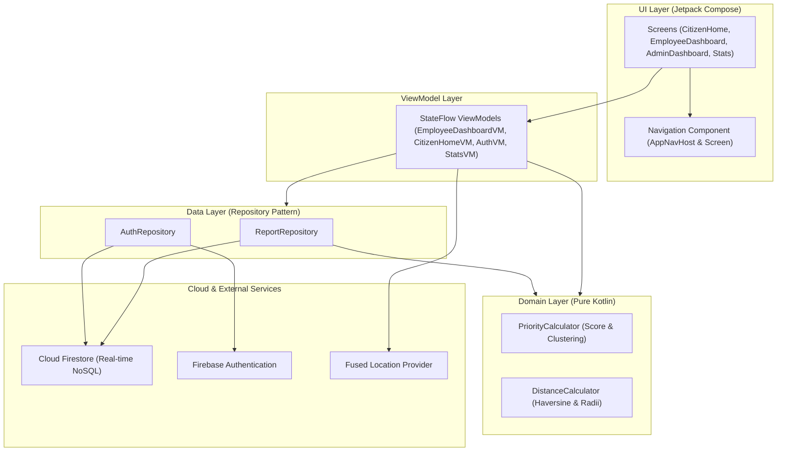

# CityFlow 🏙️

[](https://kotlinlang.org/)
[-green.svg)](https://developer.android.com/)
[](https://developer.android.com/jetpack/compose)
[](https://firebase.google.com/)
[](https://www.cs.unipi.gr/)

**CityFlow** is a modern native Android application for **Smart Urban Mobility and Accessibility Management**, developed for the Mobile Development course at the **University of Piraeus (UniPi)**.

The system connects citizens with municipal emergency dispatch and maintenance crews in real time. It automates incident prioritization, detects spatial/temporal report clusters, triggers geofenced proximity alerts, and provides a full lifecycle workflow for municipal issue resolution.

---

## 📑 Table of Contents
1. [Key Features by Role](#-key-features-by-role)
2. [Prioritization Algorithm & Domain Logic](#-prioritization-algorithm--domain-logic)
3. [Architecture & Design Patterns](#-architecture--design-patterns)
4. [Demo & Evaluation Accounts](#-demo--evaluation-accounts)
5. [Presentation Guide: Running on 2 Emulators](#-presentation-guide-running-on-2-emulators)
6. [Tech Stack](#-tech-stack)
7. [Project Structure](#-project-structure)
8. [Setup & Execution](#-setup--execution)

---

## 👥 Key Features by Role

### 1. 🚶 Citizen Flow (`CITIZEN`)
* **Incident Reporting:** Report urban accessibility issues (broken wheelchair ramps, potholes, faulty traffic lights, sidewalk obstructions, illegal parking) with:
  * Camera photo capture (compressed Base64 storage).
  * Automatic GPS geolocation with reverse street geocoding.
  * Category-based inherent severity ratings.
* **Proximity Alerts (Geo-fencing):** Real-time GPS location tracking calculates distance to verified nearby obstacles and alerts citizens when entering the danger zone.
* **Incident History:** Track submitted reports and their real-time status transitions.
* **Resolution Feed:** View public official resolution announcements published by city crews.
* **Anti-Spam De-duplication:** Automatically prevents repeated submissions from the same user for the same issue within 30 minutes and 50 meters.

### 2. 👷 Municipal Employee Flow (`EMPLOYEE`)
* **Real-time Dispatch Queue:** Live Firestore feed (`callbackFlow`) displaying all submitted urban problems without pull-to-refresh.
* **Dynamic Sorting:** Auto-ranked by calculated `PriorityScore` (most urgent first) or chronological order.
* **Status Filtering:** Filter reports by `All`, `Submitted`, `Under Review`, `Verified`, `In Progress`, `Resolved`, or `Rejected`.
* **Algorithmic Badges:** Visual severity badges (`Critical`, `High`, `Medium`, `Low`) displaying numeric score and clustered reports count.
* **Workflow Transitions:**
  * **Under Review:** Mark as being investigated.
  * **Verify:** Acknowledge and attach customizable safety advice for citizens.
  * **In Progress:** Mark active field crew work.
  * **Resolve:** Mark resolved with an official public announcement.
  * **Reject:** Reject invalid incidents with mandatory justification.
* **External Maps Navigation:** Launch coordinates directly in Google Maps or external map providers.

### 3. ⚙️ System Administrator Flow (`ADMIN`)
* **Dynamic Algorithm Tuning:** Live sliders to calibrate prioritization weights ($w_1$: Count, $w_2$: Proximity, $w_3$: Severity) between `0.5` and `5.0`.
* **Cross-Device Cloud Sync:** Weights are persisted in Cloud Firestore (`system_config/priority_weights`), broadcasting immediately to all connected devices.
* **Retroactive Queue Recalculation:** Tapping *"Apply Parameters"* updates existing active reports via atomic Firestore batch writes, causing the Employee Dashboard to re-rank and update badges live.
* **Categories & Notification Radii Oversight:** Inspect and verify base radii and severity scales for all incident types.
* **Fast Navigation:** Quick-action shortcuts to Employee Dashboard, Analytics, and Settings.

### 4. 📊 Analytics & Profile
* **Role-Aware Statistics:** Breakdown of reports by status, category, resolution times, and operational triage metrics.
* **Interactive Charts:** Category distribution and status progression charts.
* **Bilingual Support (i18n):** 100% Greek (`el`) and English (`en`) support with instantaneous in-app language switching.
* **Dark / Light Theme:** Native Material 3 theming with persistent user preferences.

---

## 🧮 Prioritization Algorithm & Domain Logic

CityFlow implements a pure Kotlin domain model for objective urgency ranking:

$$P = w_1 \cdot \text{Count} + w_2 \cdot \text{ProximityScore} + w_3 \cdot \text{Severity}$$

Where:
* **$\text{Count}$:** Number of unique citizen accounts contributing to the incident cluster (prevents single-user inflation).
* **$\text{ProximityScore}$:** Spatial density score ($0 \dots 10$) computed using the **Haversine formula** for reports within the cluster radius ($50\text{m}$).
* **$\text{Severity}$:** Inherent danger rating ($1 \dots 5$) assigned to each category (e.g., *Broken Wheelchair Ramp* = 5).
* **$w_1, w_2, w_3$:** Dynamic weights tuned in real time by the Administrator.

### Priority Tiers:
| Score Range | Priority Tier | Badge Color |
| :--- | :--- | :--- |
| $\ge 25.0$ | **CRITICAL (Κρίσιμη)** | Red |
| $18.0 \dots 24.9$ | **HIGH (Υψηλή)** | Orange |
| $12.0 \dots 17.9$ | **MEDIUM (Μέτρια)** | Amber / Yellow |
| $< 12.0$ | **LOW (Χαμηλή)** | Blue |

---

## 🏗️ Architecture & Design Patterns

The codebase strictly adheres to **Clean Architecture**, **MVVM (Model-View-ViewModel)**, and **Unidirectional Data Flow (UDF)**:



* **Pure Kotlin Domain:** [`PriorityCalculator.kt`](app/src/main/java/com/example/cityflow/domain/PriorityCalculator.kt) and [`DistanceCalculator.kt`](app/src/main/java/com/example/cityflow/domain/DistanceCalculator.kt) have zero Android framework dependencies, making them 100% testable via unit tests.
* **Coroutines & Kotlin Flow:** Uses `callbackFlow` to adapt Firebase snapshot listeners into cold/hot reactive streams.
* **Batch Writes:** Atomic Firestore commits for incident clustering and queue recalculations.
* **Resource Wrapper:** Generic `Resource<T>` (`Idle`, `Loading`, `Success`, `Error`) for predictable asynchronous UI state handling.

---

## 🔑 Demo & Evaluation Accounts

The app includes built-in demo credentials for immediate testing without external authentication dependencies:

| Role | Username / Identifier | Password | Description |
| :--- | :--- | :--- | :--- |
| **Administrator** | `admin` | `admin` | Full admin rights, algorithm sliders, employee queue access. |
| **Employee** | `employee` | `employee` | Municipal officer dashboard, report verification & status actions. |
| **Citizen** | *(Self Sign-up)* | *(Any)* | Register any account from the app Sign Up screen. |

> *Note: Email aliases `admin@cityflow.com` and `employee@cityflow.com` are also accepted.*

---

## 📱 Presentation Guide: Running on 2 Emulators

To demonstrate real-time cross-device synchronization during presentations:

1. **Duplicate or Create a Second Emulator:**
   * In Android Studio, open **Tools** > **Device Manager**.
   * Click **⋮** on your existing emulator > **Duplicate** (e.g., `Pixel - User 2`).
2. **Launch Both Emulators Side-by-Side:**
   * Start both emulators from Device Manager.
3. **Deploy App to Both Devices:**
   * In the top toolbar device selector, choose **Select Multiple Devices...**.
   * Check both emulators and click **Run (▶)** (`Shift + F10`).
4. **The Live Demo Flow:**
   * **Phone 1:** Sign in as `admin` / `admin` (open the **Admin Dashboard**).
   * **Phone 2:** Sign in as `employee` / `employee` (open the **Employee Dashboard**).
   * On **Phone 1**, slide the **Severity Weight ($w_3$)** up to `4.0` or `5.0` and tap **"Apply Parameters"**.
   * Watch **Phone 2 in real time**: Existing reports instantly recalculate their scores, switch badges (e.g. Yellow *Medium* ➜ Red *Critical*), and re-order themselves live.

---

## 🛠️ Tech Stack

* **Language:** Kotlin 2.0.21
* **UI Framework:** 100% Jetpack Compose with Material 3
* **Min SDK:** Android 7.0 (API 24) | **Target & Compile SDK:** Android 15 (API 35)
* **Architecture:** MVVM + Clean Architecture + UDF + Repository Pattern
* **Asynchronous Programming:** Kotlin Coroutines & StateFlow / SharedFlow
* **Backend:** Firebase Authentication & Cloud Firestore (NoSQL)
* **Location Services:** Google Play Services Fused Location Provider & Geocoder
* **Testing:** JUnit 4 Unit Tests

---

## 📁 Project Structure

```text
com.example.cityflow/
├── data/
│   ├── model/           # Data classes (Report, User, UserRole, ReportCategory, Resource)
│   └── repository/      # ReportRepository (Firestore batching & flows), AuthRepository
├── domain/              # Pure Kotlin domain logic
│   ├── DistanceCalculator.kt  # Haversine distance & geofence checks
│   └── PriorityCalculator.kt  # Urgency ranking model & cluster detection
├── ui/                  # 100% Jetpack Compose presentation layer
│   ├── admin/           # AdminDashboardScreen (Algorithm sliders & category overview)
│   ├── auth/            # LoginScreen, RegisterScreen, AuthViewModel
│   ├── citizen/         # CitizenHomeScreen, SubmitReportScreen, CitizenHomeViewModel
│   ├── employee/        # EmployeeDashboardScreen, EmployeeDashboardViewModel
│   ├── stats/           # StatsScreen, StatsCharts, StatsViewModel
│   ├── profile/         # ProfileScreen (Role overview, settings shortcuts)
│   ├── common/          # LocalizedModels, SettingsDialog, shared composables
│   ├── navigation/      # AppNavHost, Screen sealed hierarchy
│   └── theme/           # Color palettes, Typography, Theme definition
└── util/                # AppSettings (SharedPreferences & Language), ImageUtils, MapUtils
```

---

## 🚀 Setup & Execution

### Prerequisites
* **Android Studio:** Ladybug (2024.2.1) or newer.
* **JDK:** Java 17 or Java 21 (Temurin / OpenJDK).
* **Android SDK:** Platform 35.

### Building and Running
1. Clone the repository and open the project in Android Studio.
2. Ensure `google-services.json` is located in the `app/` folder.
3. Sync Gradle dependencies: `File > Sync Project with Gradle Files`.
4. Select a target emulator or connected device and press **Run (Shift + F10)**.

### Running Unit Tests
Execute the domain logic test suite from terminal or Android Studio:
```bash
./gradlew testDebugUnitTest
```
The test suite validates:
* Haversine distance calculations and geofence boundary validation.
* Priority score calculations for single and clustered reports.
* Dynamic weight modifications and mathematical score scaling.

---

## 📄 Documentation
For detailed architectural breakdowns and lifecycle flowcharts, see [`ARCHITECTURE.md`](ARCHITECTURE.md).
